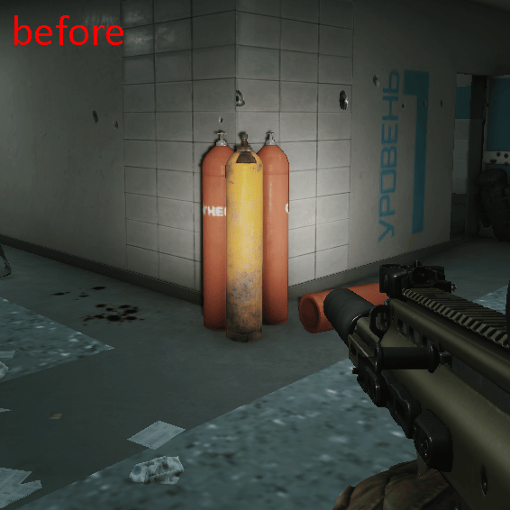

# Propane Remover

[)](https://github.com/Tosox/SPT-PropaneRemover/releases) [)](https://github.com/Tosox/SPT-PropaneRemover/releases/latest)

## 📜 Description

**Propane Remover** is a mod for *Single Player Tarkov* that removes the explosive propane tanks from the game.

## ✨ Features

* No more surprise deaths from exploding propane tanks
* Also removes other explosive objects like fire extinguishers

## 📁 Installation

* Download the latest release
* Copy the `BepInEx` folder into your SPT folder
* Start the game

## 📝 Changelog

You can check out the latest changes in [`CHANGELOG.md`](CHANGELOG.md).

## 📷 Preview

## 🙏 Credits

* Originally created by [peinwastaken](https://github.com/peinwastaken)

## 📄 License

Distributed under the MIT License. See `LICENSE` for more information.
